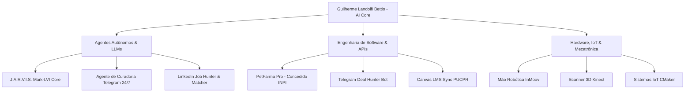

# ⚡ Portfólio de Inteligência Artificial, Software & Engenharia

<div align="center">

**Guilherme Landolfi Bettio**  
*Graduando em Ciência da Computação — PUCPR (IRA: 9,08 / 10)*  
*Autor de Software Registrado no INPI (Processo BR512025003579-9)*  
*AI Engineer & AI Builder | Automação com Agentes de IA, LLMs & Sistemas Embarcados*

[](https://www.linkedin.com/in/guilherme-landolfi-bettio-69b075266/)
[](https://github.com/Guilherme-Bettio)
[](mailto:guilherme.bettio@gmail.com)
[](https://pucpr.br)

</div>

---

## 📄 Portfólios Oficiais para Download & Visualização Direta

Abaixo estão os documentos oficiais de portfólio e comprovação mantidos neste repositório:

| Documento | Descrição | Link Direto |
| :--- | :--- | :---: |
| 🖼️ **Portfólio de Projetos (PDF)** | Portfólio técnico visual detalhando arquiteturas de software, automações e RPA | [📥 Visualizar / Baixar](Portfolio_Guilherme_Landolfi_Bettio.pdf) |
| 🦾 **Coleção de Criações (PDF)** | Catálogo completo de invenções, robótica, fabricação digital (CNC/Laser/3D) e IoT | [📥 Visualizar / Baixar](Colecao_de_Criacoes_Guilherme_Landolfi_Bettio.pdf) |
| 🎓 **Currículo Lattes Oficial (PDF)** | Registro acadêmico CNPq de pesquisas científicas e tecnológicas (PIBITI / PIBIC Jr.) | [📥 Visualizar / Baixar](Lattes.pdf) |

> ℹ️ *Nota: Currículos individuais são elaborados e direcionados sob medida para cada oportunidade e empresa parceira, sendo disponibilizados diretamente nos canais de candidatura.*

---

## 🚀 Coletânea de Projetos de Inteligência Artificial & Engenharia

Uma síntese prática dos principais sistemas, agentes autônomos e arquiteturas que desenvolvo e mantenho em produção.



---

### 1. ⚙️ J.A.R.V.I.S. // Mark-LVI Core & Antigravity Engine
> **O Assistente Pessoal Autônomo com HUD Holográfico em PyQt6, Nó Neural RTX 4060 Ti e Subagente Antigravity.**

* **Repositório / Stack:** Python 3.12, PyQt6, Whisper Large v3 Turbo, Dynamic VAD, Antigravity CLI (`agy`), Free Eleven Labs (VoxCPM2) via GPU cluster remota dedicada (RTX 4060 Ti) com FastAPI e VPN privada mesh.
* **Arquitetura & Destaques:**
  - **Ponte Nativa de Código:** O assistente dispara comandos e raciocínio pesado diretamente no terminal da CLI do Antigravity, delegando tarefas assíncronas sem travar a interface.
  - **Pipeline de Áudio Resiliente:** Normalização dinâmica de ganho a 92% da escala total, com supressão bidirecional de eco acústico (*auto-mute*) e roteamento dinâmico de hardware (AirPods Bluetooth vs alto-falante Realtek).
  - **Roteamento Semântico Ultrarrápido:** Diálogo multi-turno com resolução de anáforas (lembra do contexto anterior) e chit-chat respondido em menos de 2ms.

<details>
<summary>🧠 <b>Ver Prompt de Engenharia: Roteamento Semântico & Resolução de Anáfora</b></summary>

```markdown
Você é o núcleo de raciocínio de contexto do J.A.R.V.I.S.
Sua missão é classificar a intenção do usuário, resolver anáforas e estruturar a carga útil para execução imediata em menos de 50ms.

DIRETRIZES DE RESOLUÇÃO:
1. Resolução de Anáfora: Se a mensagem do usuário referenciar um sujeito omitido (ex: "e o euro?", "quanto está agora?", "mostre o código"), consulte o histórico imediato para recuperar a entidade original.
2. Diálogo Incompleto: Se a instrução for ambígua, retorne a pergunta exata de esclarecimento para o TTS falar ao usuário (ex: "Como está o quê, senhor?").
3. Anti-Alucinação: Não invente valores numéricos ou fatos externos; acione as ferramentas disponíveis ('tools') para obter dados atualizados.
4. Formato de Saída Obrigatório (JSON estrito sem markdown):
{
  "intent": "action_execution" | "clarification_needed" | "instant_reply",
  "action_name": "get_finance_quote" | "run_antigravity_task" | "system_control" | null,
  "resolved_entities": {
    "target": "string",
    "params": {}
  },
  "speech_response": "Texto claro, conciso e educado para sintetizar em voz humana"
}
```
</details>

---

### 2. 📱 Agente Autônomo de Curadoria 24/7 (`@Gui_Links_Bot` + Google Sheets)
> **Captura Contínua via iOS Share Sheet, Processamento Serverless e Síntese Multimodal com LLMs.**

* **Stack:** Google Apps Script, Webhooks Serverless, Telegram Bot API, Python 3, Trafilatura, Google Sheets API.
* **Problema & Impacto:** Eliminar dezenas de horas semanais de leitura e organização manual de links técnicos dispersos salvos pelo celular.
* **Como Funciona:**
  1. O usuário compartilha qualquer link pelo iPhone (Safari, YouTube, Instagram, X/Twitter, TikTok) diretamente para o `@Gui_Links_Bot`.
  2. O webhook serverless grava imediatamente o link na planilha do Google Sheets.
  3. O daemon de IA acessa as páginas, extrai o conteúdo limpo, executa análise semântica multimodal e regrava o resumo estruturado com tags e nível de relevância nas células da planilha.

<details>
<summary>🧠 <b>Ver Prompt de Engenharia: Extração Estruturada & Síntese de Conteúdo Técnico</b></summary>

```markdown
Você é um pesquisador sênior de inteligência artificial e engenharia de software encarregado de curadoria técnica.
Analise o conteúdo bruto da página web e sintetize um relatório conciso e acionável.

REGRAS DE EXTRAÇÃO:
- Identifique: Tecnologias centrais, ferramentas de código aberto mencionadas, arquiteturas descritas e links de repositórios.
- Ignore: Banners, anúncios, menus de navegação, cookies e chamadas promocionais genéricas.
- Formato de Retorno (JSON estrito):
{
  "titulo_limpo": "Título técnico descritivo",
  "categoria": "LLM / Agentes" | "DevOps & Cloud" | "Engenharia de Software" | "Hardware / Maker" | "Outros",
  "resumo_executivo": "Parágrafo direto de 2 a 3 frases explicando exatamente o que o projeto/artigo faz e o problema que resolve.",
  "tecnologias_chave": ["tag1", "tag2", "tag3"],
  "nivel_relevancia": "Alto" | "Médio" | "Baixo",
  "acao_recomendada": "Ação concreta (ex: 'Clonar repositório e testar integração com Antigravity', 'Ler documentação da API')"
}
```
</details>

---

### 3. 🤖 LinkedIn Job Hunter & Profile Matcher Bot
> **Agente Inteligente com Web Scraping Stealth, Avaliação Semântica por LLM e Gerador de Pitches Customizados.**

* **Stack:** Python 3, Playwright, BeautifulSoup, LLM Orchestration (Gemini / Claude API), JSON Schema.
* **Destaques:**
  - **Scraping Anti-Detecção:** Coleta automática de descrições e requisitos de vagas com tratamento avançado de requisições e rotação de headers.
  - **Avaliação de Aderência:** Compara semânticamente os requisitos obrigatórios e desejáveis contra as competências do perfil, calculando notas de compatibilidade percentual.
  - **Geração de Pitch:** Produz abordagens personalizadas e empáticas para mensagens diretas a recrutadores, destacando projetos que comprovam cada habilidade requerida.

<details>
<summary>🧠 <b>Ver Prompt de Engenharia: Avaliação Multidimensional de Fit de Vagas</b></summary>

```markdown
Você é um recrutador técnico sênior especializado em Inteligência Artificial e Engenharia de Software.
Compare o perfil do candidato com a descrição da vaga abaixo e execute uma avaliação imparcial e quantitativa.

DADOS DE ENTRADA:
- PERFIL DO CANDIDATO: {candidate_profile}
- DESCRIÇÃO DA VAGA: {job_description}

CRITÉRIOS DE AVALIAÇÃO:
1. Hard Skills (40%): Aderência de linguagens, frameworks, banco de dados e APIs.
2. Projetos e Evidências Práticas (35%): Projetos já entregues que comprovam capacidade de execução rápida.
3. Formação e Idiomas (15%): Nível de ensino, curso e idiomas compatíveis.
4. Fit Cultural & Metodologias (10%): Senso de dono, métodos ágeis (Scrum), protagonismo.

SAÍDA ESPERADA:
- Score Geral: 0 a 100%
- Gaps Identificados: Pontos que o candidato precisará desenvolver ou compensar.
- Argumentos-Chave: 3 fatos concretos do candidato que respondem diretamente às maiores dores da vaga.
- Pitch de Abordagem: Mensagem profissional de até 4 frases pronta para envio ao gestor da vaga.
```
</details>

---

### 4. 🏆 PetFarma Pro — Automação Farmacêutica & Rastreabilidade via QR Code
> **Software com Registro Oficial Concedido pelo INPI (Processo: BR512025003579-9).**

* **Origem:** Iniciação Tecnológica (PIBITI / PUCPR) sob metodologia ágil **Scrum**.
* **Problema:** Descontrole de estoque, falhas manuais de dispensação e falta de rastreabilidade de medicamentos veterinários em clínicas universitárias.
* **Solução & Resultados:**
  - Concepção de uma plataforma em nuvem onde cada lote e medicamento possui identificador exclusivo em QR Code dinâmico.
  - Validação da prescrição e baixa de estoque instantâneas via scanner, eliminando risco de erro humano e reduzindo tempo de auditoria em mais de **70%**.
  - Concessão oficial da Carta de Registro de Programa de Computador pelo Instituto Nacional da Propriedade Industrial (INPI).

---

### 5. 🔍 Telegram Deal Hunter Bot
> **Automação de Coleta & Monitoramento Contínuo de Hardware em Tempo Real.**

* **Stack:** Python 3, Selenium / Playwright, Telegram Bot API, Regex, Logging Estruturado.
* **Destaques:** Monitora flutuações de preços em tempo real em dezenas de páginas de e-commerce, filtrando falsas promoções através de histórico e disparando notificações formatadas para canais privados com rotinas de auto-recuperação de rede.

---

### 6. 🏛️ Pipeline Canvas LMS & Automações Acadêmicas (PUCPR)
> **Sincronização Consciente de Dados Institucionais com Cache Local.**

* **Stack:** Python 3, Canvas LMS REST API, Markdown Dashboards.
* **Destaques:** Integração com a API da Pontifícia Universidade Católica do Paraná para coleta de notas, prazos e cronogramas de provas, mantendo um cache local em Markdown atualizado sem sobrecarregar os servidores institucionais nem violar rate-limits.

---

### 7. 🦾 Engenharia Física & Mecatrônica (Hardware + Software)
* **Mão Robótica InMoov:** Prótese mecânica funcional impressa em 3D, com articulação de garras via servomotores microcontrolados por Arduino/ESP32 e rotinas em C/C++.
* **Scanner 3D Kinect (Xbox 360):** Engenharia reversa e calibração de sensores infravermelhos de profundidade para reconstrução e digitalização tridimensional de baixo custo em arquivos STL/OBJ.
* **Sistemas IoT no Espaço CMaker:** Projetos funcionais de estufa automatizada, irrigador inteligente e máquina de vendas operando com sensores de temperatura, umidade e relés microcontrolados.

---

## 🛠️ Matriz Geral de Competências

| Categoria | Tecnologias, Ferramentas & Práticas |
| :--- | :--- |
| **Inteligência Artificial & LLMs** | Agentes Autônomos, Prompt Engineering Avançado, Gemini API, Claude API, OpenAI GPT, Whisper, Function Calling, Structured Outputs, RAG |
| **Linguagens de Programação** | Python 3 (asyncio, FastAPI, BeautifulSoup, Playwright, Selenium), C, C++, JavaScript / Node.js, SQL, Shell Script |
| **Automação & Integrações** | Webhooks Serverless, Google Apps Script, Telegram Bot API, Web Scraping Stealth, RPA |
| **Engenharia de Software & DevOps** | Git, GitHub, Linux, Docker, Arquitetura de Microsserviços, Metodologias Ágeis (Scrum), Registro INPI |
| **Hardware & Fabricação Digital** | Arduino, ESP32, Impressão 3D (FDM/Resina), Corte a Laser CO2, Fresadora CNC |

---

## 📬 Contato

- 📍 **Localização:** Curitiba, PR — Brasil (Disponibilidade para atuação Remota)
- 💼 **LinkedIn:** [linkedin.com/in/guilherme-landolfi-bettio-69b075266](https://www.linkedin.com/in/guilherme-landolfi-bettio-69b075266/)
- 💻 **GitHub:** [github.com/Guilherme-Bettio](https://github.com/Guilherme-Bettio)
- 📧 **E-mail:** [guilherme.bettio@gmail.com](mailto:guilherme.bettio@gmail.com)
